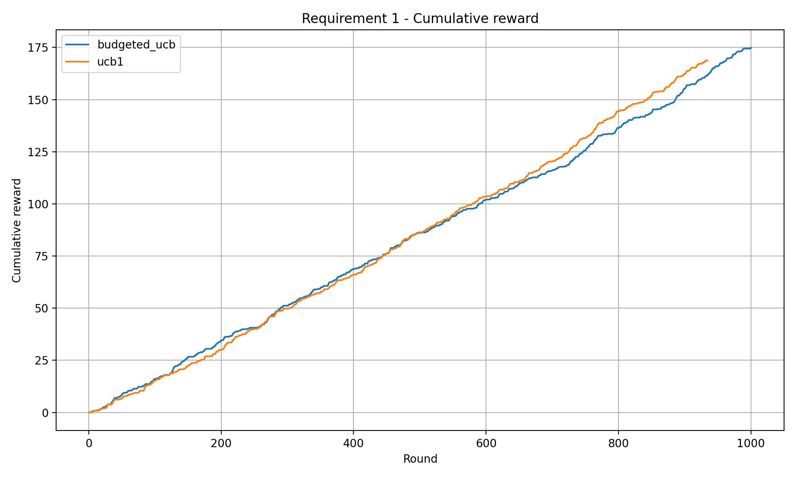
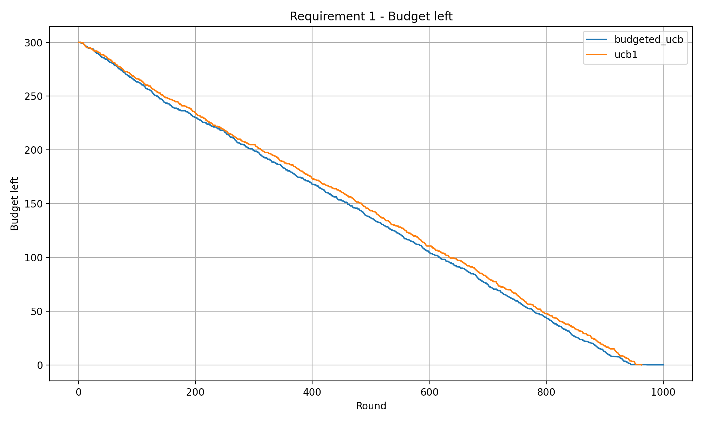

# Online Advertising Bidding Strategy

A Python framework for simulating advertising auctions and evaluating online bidding strategies under budget constraints, campaign conflicts, and changing market conditions.

Developed for the **Online Learning Applications** course at **Politecnico di Milano**.

**Python · NumPy · SciPy · Pandas · Multi-Armed Bandits · Online Optimization**

## Overview

An advertiser must repeatedly decide how much to bid while learning about competing bids and managing a limited budget.

The project studies how different learning strategies handle this problem, starting with a single campaign and extending to multiple campaigns, incompatibility constraints, and non-stationary markets.

The framework separates learning algorithms, auction environments, experiment configuration, result logging, and analysis. The repository includes executable experiments, tests, notebooks, saved results, and presentation material.

## Auction Model

In the single-campaign first-price environment, the advertiser selects a bid `b_t` and observes the outcome of the auction.

An auction is won when the selected bid is at least as high as the highest competing bid.

For campaign value `v`:

```text
win_t    = 1 if b_t >= highest_competing_bid_t, otherwise 0
cost_t   = b_t × win_t
reward_t = (v - b_t) × win_t
```

The remaining budget is updated after each round.

This creates a trade-off between:

- Exploring bids to learn their performance.
- Selecting bids with high expected reward.
- Preserving budget for future rounds.
- Adapting when market behavior changes.

## Implemented Scenarios

### 1. Single Campaign in a Stochastic Market

Comparison of:

- UCB1.
- Budget-aware UCB.
- UCB1-Tuned.
- Rescaled exploration variants.
- Budget-aware versions of the exploration variants.

The experiments examine reward, spending, budget depletion, action selection, and regret relative to the selected benchmarks.

### 2. Multiple Campaigns

A multi-campaign environment with:

- A joint distribution over competing bids.
- Combinatorial UCB.
- Budget constraints.
- A conflict graph representing campaigns that cannot be selected together.

### 3. Primal-Dual Bidding

A factorized primal-dual method for budget-constrained multi-campaign bidding.

The shared comparison protocol uses:

- A 3,000-round horizon.
- 10 campaigns.
- Nine combinations of market-change frequency and distribution separation.
- 10 saved market realizations per setting.
- A piecewise-static hindsight oracle for evaluation.

### 4. Non-Stationary Markets

Comparison of approaches that respond to changing market distributions:

- Sliding-window Combinatorial UCB.
- Change-detector Combinatorial UCB.
- Primal-dual bidding in the shared comparison experiments.

Individual experiment runners can use different configurations. Refer to their configuration files and source code for the exact protocol.

## Example Results

### Cumulative Reward



### Remaining Budget



These figures are saved outputs from the simulation experiments. Their interpretation depends on the budget setting, algorithm assumptions, and benchmark used.

Additional figures are available in [results/plots](results/plots).

## Technology Stack

| Purpose | Libraries and Tools |
|---|---|
| Numerical computation | NumPy, SciPy |
| Result processing | Pandas |
| Visualization | Matplotlib |
| Configuration | YAML |
| Graph constraints | NetworkX |
| Optimization support | CVXPY |
| Spreadsheet exports | XlsxWriter |
| Testing | pytest |
| Interactive analysis | Jupyter notebooks |

## Repository Structure

```text
OnlineAdvertisingBiddingStrategy/
├── ola/
│   ├── algorithms/       # Learning and bidding strategies
│   ├── environments/     # Auction and market environments
│   └── utils/            # Logging, plotting, graphs, and benchmarks
├── experiments/          # Experiment runners
├── configs/              # Experiment settings
├── notebooks/            # Interactive analysis
├── tests/                # Automated validation
├── results/
│   ├── raw/              # Per-round experiment outputs
│   ├── processed/        # Processed results and shared realizations
│   ├── plots/            # Generated figures
│   └── exports/          # Exported tables
├── slides/               # Presentation material
├── requirements.txt
├── pytest.ini
└── CONTRIBUTING.md
```

## Installation

```bash
git clone https://github.com/FoadZahediLabaf/OnlineAdvertisingBiddingStrategy.git
cd OnlineAdvertisingBiddingStrategy

python3 -m venv .venv
source .venv/bin/activate

python -m pip install -r requirements.txt
```

On Windows PowerShell, activate the environment with:

```powershell
.venv\Scripts\Activate.ps1
```

Run experiment commands from the repository root.

## Run a Single-Campaign Experiment

```bash
python experiments/run_req1.py
```

The runner reads:

```text
configs/req1.yaml
```

The current configuration specifies:

| Setting | Value |
|---|---|
| Horizon | 1,000 rounds |
| Initial budget | 300 |
| Campaign value | 1.0 |
| Bid set | 0.0 to 1.0, with increments of 0.1 |
| Highest competing bid | Uniform distribution on [0.1, 0.7] |
| Random seed | 42 |

The runner saves per-round CSV outputs under `results/raw/` and generates comparison figures under `results/plots/`.

Change the configuration file to explore different horizons, budgets, bid sets, and market parameters.

## Additional Experiments

| Runner | Purpose |
|---|---|
| `experiments/run_req2.py` | Multi-campaign stochastic experiments |
| `experiments/run_req4.py` | Sliding-window experiments |
| `experiments/run_req4_cd.py` | Change-detector experiments |
| `experiments/generate_req4_shared_realizations.py` | Shared market realization generation |
| `experiments/run_req3_on_shared_realizations.py` | Primal-dual evaluation on shared realizations |
| `experiments/run_req4_sw_on_shared_realizations.py` | Sliding-window evaluation on shared realizations |
| `experiments/run_req4_cd_on_shared_realizations.py` | Change-detector evaluation on shared realizations |

Shared-realization experiments require the corresponding market data. Inspect each runner's configuration and command-line options before launching the complete comparison.

## Result Format

Experiment outputs use a shared CSV schema:

```text
algorithm,round,action,bids,wins,reward,cost,budget_left,cumulative_reward,cumulative_cost,benchmark_reward,instant_regret,cumulative_regret
```

| Field | Meaning |
|---|---|
| `algorithm` | Strategy being evaluated |
| `round` | Auction round |
| `action` | Selected action or policy identifier |
| `bids` | Selected bid or campaign bid vector |
| `wins` | Auction outcome or campaign outcome vector |
| `reward` | Reward obtained during the round |
| `cost` | Budget spent during the round |
| `budget_left` | Remaining budget |
| `cumulative_reward` | Total reward so far |
| `cumulative_cost` | Total spending so far |
| `benchmark_reward` | Benchmark reward, where implemented |
| `instant_regret` | Per-round regret, where implemented |
| `cumulative_regret` | Accumulated regret, where implemented |

Benchmark and regret fields remain empty when they are not implemented for an experiment. Additional metadata columns may follow the shared fields.

## Testing

Run the test suite with:

```bash
python -m pytest -q
```

The tests cover areas including:

- UCB action selection and updates.
- Budget-aware bidding behavior.
- Auction environment behavior.
- Campaign conflict constraints.
- Multi-campaign validation.
- Benchmark and oracle calculations.
- Synthetic market construction.

## Reproducibility

The framework uses configuration files and seeded random generation to make experiment settings inspectable.

When comparing results, record:

- The experiment runner and configuration.
- Horizon, campaign count, and initial budget.
- Bid set and campaign values.
- Market distribution and change settings.
- Random seeds or saved realization identifiers.
- Algorithm parameters.
- Benchmark definition.

Comparisons should use compatible market realizations, budgets, and feedback assumptions.

## Team

- Foad Zahedi Labaf
- Simone Mauro
- Alessandro Sartori
- Luigi Cavuto
- Mengyao Li

See [CONTRIBUTING.md](CONTRIBUTING.md) for the team's workflow and file ownership rules.

## Presentation

The [final presentation](slides/Final%20Presentation.pptx) describes the project methodology and experimental comparisons.

## Project Context

This project evaluates bidding strategies in simulated advertising markets. Its results characterize the implemented experimental settings and provide a basis for studying the interaction between learning, budget management, and market adaptation.

## Copyright

© 2026 the respective project contributors. All rights reserved.

Third-party materials remain subject to their original licenses and terms.
